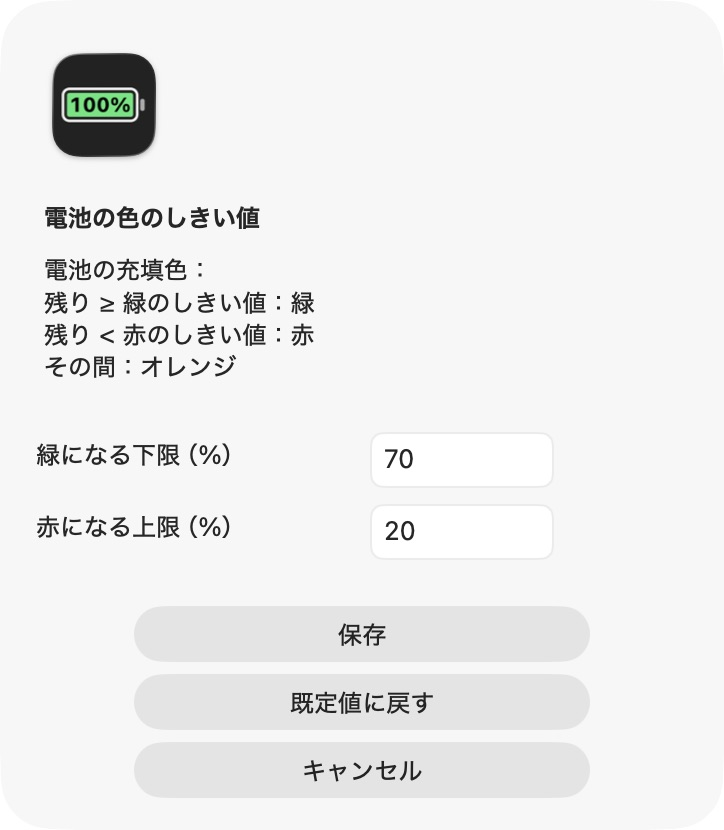

<h1 align="center">Codex Battery</h1>

<p align="center"><strong>Codex の残り利用枠を、ひと目で。</strong></p>
<p align="center"><a href="README.md">English</a> · <a href="README.zh-CN.md">简体中文</a> · <a href="README.ja.md">日本語</a></p>

<p align="center">
  <a href="https://github.com/AdvancingTitans/codex-battery/releases/download/v1.2.0/CodexBattery-1.2.0-universal.zip"></a>
  <a href="LICENSE"></a>
</p>


**Codex の残り利用枠を電池として表示する**、macOS ネイティブのメニューバーアプリです。残りの割合を電池の中に表示し、充填色が利用枠に応じて変わります。

**[v1.2.0 をダウンロード — Apple Silicon / Intel](https://github.com/AdvancingTitans/codex-battery/releases/download/v1.2.0/CodexBattery-1.2.0-universal.zip)** · [すべてのリリース](https://github.com/AdvancingTitans/codex-battery/releases) · [不具合の報告](https://github.com/AdvancingTitans/codex-battery/issues/new/choose)

## 残りの利用枠が、ひと目でわかる

- **電池で確認：** 電池内に残りの割合を表示し、利用枠に応じて充填量が変わります。
- **色のしきい値を変更：** 既定では 70%以上が緑、20%以上70%未満がオレンジ、20%未満が赤。両方の境界値を編集できます。
- **期間を選択：** 5時間、週間、または残りが少ない方の利用枠を表示。メニューでリセット時刻も確認できます。
- **定期更新：** 既定は30秒。15 / 30 / 60 / 300秒から選ぶか、手動で更新できます。
- **ネイティブ UI：** Swift + AppKit。Dock アイコンなし、ライト／ダーク対応、ログイン時の起動は任意です。
- **3言語対応：** アプリと README は英語・簡体字中国語・日本語に対応。macOS の優先言語を使用し、その他の言語では英語を表示します。

<p align="center"></p>

*例の値をアプリ本体の描画処理で表示したものです。実際のアカウントの使用量や予測ではありません。*

## インストール

**macOS 13以降**、インストール済みの [Codex CLI](https://learn.chatgpt.com/docs/cli)、Codex の利用枠を取得できる ChatGPT アカウントでの CLI ログインが必要です。API キーのみのアカウントには対応する利用枠の表示がありません。

1. CLI にログインしていない場合：
   ```sh
   codex login
   ```
2. [ユニバーサル ZIP をダウンロード](https://github.com/AdvancingTitans/codex-battery/releases/download/v1.2.0/CodexBattery-1.2.0-universal.zip)して解凍し、**Codex Battery.app** を `/Applications` または `~/Applications` に移動します。
3. アプリを開き、メニューバーの電池をクリックして詳細と設定を確認します。

配布版は **ad-hoc 署名であり、Apple の公証は受けていません**。ダウンロードしたアプリが macOS によってブロックされる場合があります。ソースからのビルドも可能です。システムの確認については [Apple の説明](https://support.apple.com/guide/mac-help/open-a-mac-app-from-an-unidentified-developer-mh40616/mac)をご覧ください。Release の `SHA256SUMS` で整合性を確認できます。

## 色を自分で設定する

電池 → **「電池の色のしきい値…」** を開き、緑になる下限と赤になる上限を設定して保存します。0〜100 の整数を使用し、赤のしきい値を緑より小さくしてください。すぐに反映され、再起動後も保持されます。「既定値に戻す」で 70 / 20 を入力し、「保存」で適用できます。

<p align="center"></p>

色が付くのは **電池の充填部分** です。数字は白黒でコントラストを保ちます。0%では充填部分は空になります。

## 仕組みとプライバシー

ローカルで `codex app-server --stdio` を起動し、公式の [`account/rateLimits/read`](https://learn.chatgpt.com/docs/app-server) から `codex` の利用枠を取得します。CLI のログインを利用し、モデルへの対話は開始しません。

- 独自サーバーやアプリのテレメトリーはなく、ブラウザー Cookie の取得や認証情報の複製もしません。
- 設定は macOS UserDefaults に保存し、利用枠のスナップショットはメモリーに保持します。
- Codex CLI は既存の設定に従って認証付きネットワークリクエストを行います。
- デスクトップ版と比較する場合は、CLI も同じアカウントにしてください。

`?` は更新失敗、`—` は選択した期間のデータがないことを示します。更新失敗時は前回の値をメニュー内で明示します。割合は切り捨てです。期間とリセット時刻は Codex の応答に依存し、アカウントにより異なります。トークン数や請求額の計測ではありません。

## ソースからビルド

Xcode Command Line Tools が必要です。アプリのビルドにサードパーティーライブラリーやパッケージマネージャーは不要です。

```sh
git clone https://github.com/AdvancingTitans/codex-battery.git
cd codex-battery
./build.sh
```

macOS 13以降を対象とするユニバーサルアプリをビルドし、ローカル署名と3言語のチェックを実行して、ZIP とチェックサムを `dist/` に出力します。[開発とリリースの検証](docs/DEVELOPMENT.md)も参照してください。

## サポートと貢献

[再現できる不具合の報告](https://github.com/AdvancingTitans/codex-battery/issues/new/choose)、翻訳、範囲を絞った改善を歓迎します。[CONTRIBUTING](CONTRIBUTING.md)、[SUPPORT](SUPPORT.md)、[SECURITY](SECURITY.md)をご確認ください。

複数の AI サービスをまとめて確認したい場合は [CodexBar](https://github.com/steipete/CodexBar)もご覧ください。このプロジェクトは Codex の電池表示に焦点を当てています。

MIT ライセンス。OpenAI とは提携していないコミュニティープロジェクトです。役立った場合は Star でブックマークできます。
