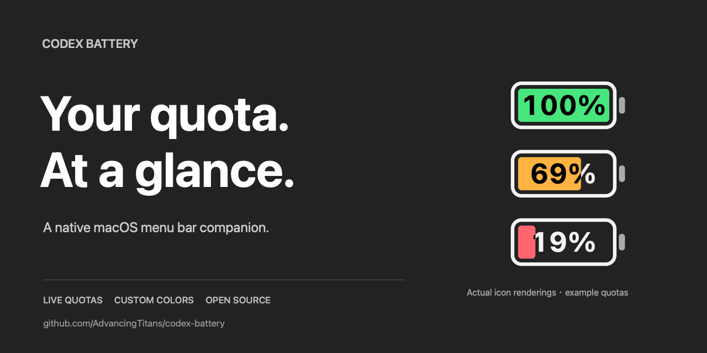
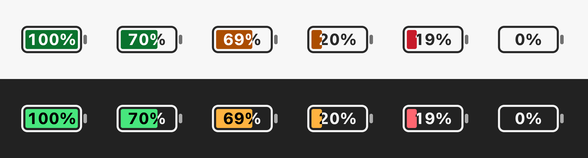
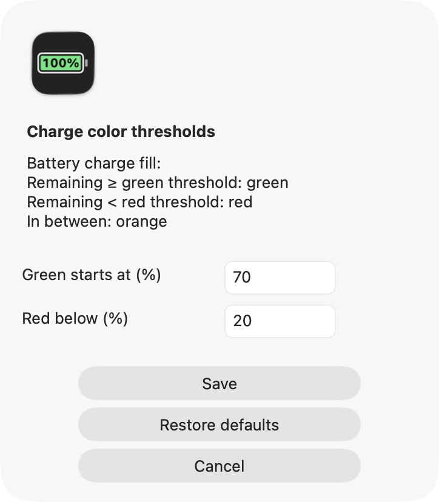

<h1 align="center">Codex Battery</h1>

<p align="center"><strong>Your Codex quota. At a glance.</strong></p>
<p align="center"><a href="README.md">English</a> · <a href="README.zh-CN.md">简体中文</a> · <a href="README.ja.md">日本語</a></p>

<p align="center">
  <a href="https://github.com/AdvancingTitans/codex-battery/releases/download/v1.2.0/CodexBattery-1.2.0-universal.zip"></a>
  <a href="LICENSE"></a>
</p>



A native macOS menu bar app that turns your **remaining Codex quota into a battery**. The percentage lives inside the icon. The charge fill changes color as your quota drops.

**[Download v1.2.0 — Apple Silicon + Intel](https://github.com/AdvancingTitans/codex-battery/releases/download/v1.2.0/CodexBattery-1.2.0-universal.zip)** · [All releases](https://github.com/AdvancingTitans/codex-battery/releases) · [Report a problem](https://github.com/AdvancingTitans/codex-battery/issues/new/choose)

## See your quota without opening another window

- **One glance:** remaining percentage inside the battery, with a fill proportional to the quota left.
- **Your thresholds:** green at ≥70%, orange at 20–<70%, red below 20% by default. Both boundaries are editable.
- **The right window:** show the 5-hour quota, weekly quota, or the lower remaining value. The menu shows reset times.
- **Fresh data:** refresh every 30 seconds by default; choose 15, 30, 60 or 300 seconds, or refresh manually.
- **Native and focused:** Swift + AppKit, no Dock icon, light/dark appearance, optional launch at login.
- **Three languages:** English, 简体中文 and 日本語 in the app and documentation. The interface follows your macOS preferred language, with English as fallback.

<p align="center"></p>

*These are real outputs from the app's icon renderer using example inputs, not account usage or a prediction.*

## Install

Requires **macOS 13 or later**, an installed [Codex CLI](https://learn.chatgpt.com/docs/cli), and a ChatGPT-backed CLI sign-in that returns Codex rate limits. API-key-only accounts do not provide this quota view.

1. Sign in to the CLI if needed:
   ```sh
   codex login
   ```
2. [Download the universal ZIP](https://github.com/AdvancingTitans/codex-battery/releases/download/v1.2.0/CodexBattery-1.2.0-universal.zip), unzip it, and move **Codex Battery.app** into `/Applications` or `~/Applications`.
3. Open the app. Look for the battery in your menu bar, then click it for quota details and settings.

The release is **ad-hoc signed and not Apple-notarized**. macOS may block downloaded builds. You can build from source below; Apple's [unknown-developer guidance](https://support.apple.com/guide/mac-help/open-a-mac-app-from-an-unidentified-developer-mh40616/mac) explains the system's checks. The release includes `SHA256SUMS` for integrity verification.

## Make the colors yours

Click the battery → **Charge color thresholds…**. Set **Green starts at (%)** and **Red below (%)**, then save. Values must be integers from 0 to 100, with the red threshold below the green threshold. Changes apply immediately and persist across restarts. **Restore defaults** fills in 70 / 20; choose **Save** to apply.

<p align="center"></p>

The **charge fill** changes color. Digits stay neutral with contrast over filled and empty areas. A 0% battery has no fill.

## How it works & privacy

The app starts a local `codex app-server --stdio` process and reads [`account/rateLimits/read`](https://learn.chatgpt.com/docs/app-server). It uses the CLI's existing sign-in and asks for the `codex` bucket. It does not start model turns.

- No app backend, analytics, browser-cookie scraping, or copied login credentials.
- Preferences stay in macOS UserDefaults. The quota snapshot stays in memory.
- Codex CLI performs its own authenticated network requests using its existing configuration.
- Make sure the CLI and the Codex desktop app use the same account if you compare their numbers.

`?` means a refresh failed; the menu labels retained numbers as previous data. `—` means the selected window is unavailable. Percentages are rounded down. Availability and reset times come from Codex, so some accounts may expose different windows. This is quota headroom, not a token counter or a billing estimate.

## Build from source

Requires Xcode Command Line Tools. No third-party app libraries or package manager are needed to build.

```sh
git clone https://github.com/AdvancingTitans/codex-battery.git
cd codex-battery
./build.sh
```

The script builds a universal app targeting macOS 13+, signs it locally, runs deterministic checks in all three languages, and writes the ZIP plus checksums to `dist/`. See [development and release checks](docs/DEVELOPMENT.md).

## Support & contribute

[Report a reproducible bug](https://github.com/AdvancingTitans/codex-battery/issues/new/choose), improve a translation, or suggest a small focused improvement. Read [CONTRIBUTING](CONTRIBUTING.md), [SUPPORT](SUPPORT.md) and [SECURITY](SECURITY.md).

Want usage tracking across many AI providers? [CodexBar](https://github.com/steipete/CodexBar) is worth a look. Codex Battery focuses on the Codex quota battery described here.

MIT licensed. Community project, not affiliated with OpenAI. If this is useful, a star helps you find it again.
