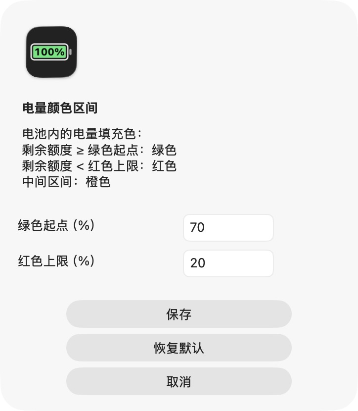

<h1 align="center">Codex Battery</h1>

<p align="center"><strong>像看电池一样，看懂 Codex 剩余额度。</strong></p>
<p align="center">[English](README.md) · [简体中文](README.zh-CN.md) · [日本語](README.ja.md)</p>

<p align="center">
  <a href="https://github.com/AdvancingTitans/codex-battery/releases/download/v1.2.0/CodexBattery-1.2.0-universal.zip"></a>
  <a href="LICENSE"></a>
</p>


一个原生 macOS 菜单栏小工具，把 **Codex 剩余额度变成一块电池**。百分比写在电池内部，电量填充条随剩余额度切换颜色。

**[下载 v1.2.0 — Apple Silicon + Intel 通用版](https://github.com/AdvancingTitans/codex-battery/releases/download/v1.2.0/CodexBattery-1.2.0-universal.zip)** · [全部版本](https://github.com/AdvancingTitans/codex-battery/releases) · [反馈问题](https://github.com/AdvancingTitans/codex-battery/issues/new/choose)

## 抬眼就知道还能用多少

- **电量一眼可见：** 电池内部显示剩余百分比，填充长度随额度变化。
- **区间自己定：** 默认 ≥70% 绿色、20%–不足70% 橙色、<20% 红色；两个分界值均可修改。
- **查看不同周期：** 可显示 5 小时、每周，或两者中较低的剩余额度；菜单显示重置时间。
- **定时刷新：** 默认每 30 秒读取一次，可选 15 / 30 / 60 / 300 秒，也可手动刷新。
- **原生轻界面：** Swift + AppKit，无 Dock 图标，适配深浅色，可选登录时启动。
- **三种语言：** 应用及 README 提供中文、英文、日文，界面跟随 macOS 首选语言，其他语言回退英文。

<p align="center"></p>

*图中使用示例额度，直接调用应用的真实图标绘制代码生成，不代表账号实际用量，也不预测消耗速度。*

## 安装

需要 **macOS 13 或更新版本**、已安装的 [Codex CLI](https://learn.chatgpt.com/docs/cli)，以及能返回 Codex 额度的 ChatGPT 账号登录状态。仅使用 API Key 的账号不提供此额度视图。

1. 如果 CLI 尚未登录，在终端执行：
   ```sh
   codex login
   ```
2. [下载通用版 ZIP](https://github.com/AdvancingTitans/codex-battery/releases/download/v1.2.0/CodexBattery-1.2.0-universal.zip)，解压，将 **Codex Battery.app** 拖入 `/Applications` 或 `~/Applications`。
3. 打开应用，在菜单栏找到电池图标；点击查看额度和设置。

发布包采用 **ad-hoc 本地签名，尚未经过 Apple 公证**，下载的应用可能被 macOS 拦截。也可按下文从源码构建；系统检查机制见 [Apple 官方说明](https://support.apple.com/guide/mac-help/open-a-mac-app-from-an-unidentified-developer-mh40616/mac)。Release 附带 `SHA256SUMS`，用于校验文件完整性。

## 自定义电量颜色

点击电池 → **「电量颜色区间…」**，设置「绿色起点（%）」与「红色上限（%）」后保存。输入须为 0–100 的整数，红色上限须小于绿色起点。保存立即生效，重启后保留。「恢复默认」会填入 70 / 20，再点「保存」即可应用。

<p align="center"></p>

颜色用于 **电量填充条**，数字保持黑白对比。0% 时电池为空。

## 数据来源与隐私

应用在本机启动 `codex app-server --stdio`，通过官方 [`account/rateLimits/read`](https://learn.chatgpt.com/docs/app-server) 读取 `codex` 额度分组，复用 CLI 已有登录状态，不发起模型对话。

- 无自建服务、无应用遥测，不抓取浏览器 Cookie，也不复制登录凭证。
- 设置保存在 macOS UserDefaults，用量快照仅保留在内存。
- Codex CLI 会按已有配置向其服务发送认证网络请求。
- 如与桌面 Codex 对比，先确认两者使用同一账号。

`?` 表示刷新失败，菜单会将保留数据标为「上次数据」；`—` 表示所选周期不可用。剩余百分比向下取整。周期及重置时间以 Codex 返回为准，部分账号可能返回不同周期。它显示额度余量，不是 Token 计数器或账单估算器。

## 从源码构建

需要 Xcode Command Line Tools。应用构建不依赖第三方库或包管理器。

```sh
git clone https://github.com/AdvancingTitans/codex-battery.git
cd codex-battery
./build.sh
```

脚本生成以 macOS 13 为最低目标版本的通用应用，进行本地签名，运行三种语言的确定性检查，在 `dist/` 输出 ZIP 与校验文件。详见 [开发与发布检查](docs/DEVELOPMENT.md)。

## 反馈与参与

欢迎[反馈可复现问题](https://github.com/AdvancingTitans/codex-battery/issues/new/choose)、改进翻译或提出小而明确的改进。请阅读 [贡献说明](CONTRIBUTING.md)、[支持说明](SUPPORT.md) 和 [安全政策](SECURITY.md)。

如果需要同时查看更多 AI 服务的用量，可以看看 [CodexBar](https://github.com/steipete/CodexBar)。本项目专注于上述 Codex 额度电池。

MIT 许可证。社区项目，与 OpenAI 无隶属关系。若对你有用，可以点 Star 留作书签。
